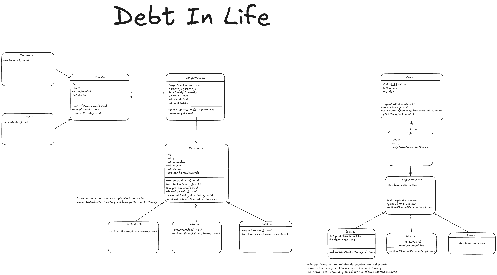

# Proyecto: Debt_In_Life

## 1. Integrantes del Equipo 

- Cabrera, David 
- Del Rio, Axel 
- Romero, Ignacio 
- Vasquez, Joaquin

## 2. Dominio y Alcance del Sistema 

## Descripción del Problema

Buscamos desarrollar un videojuego inspirado en Pac-man. El jugador debe recolectar la cantidad de puntos objetivo (Dinero), evitando los enemigos los cuales restarán puntos al jugador si los toca. La partida tendrá 3 niveles nombrados como Estudiante, Adulto y como nivel final Jubilado.

## Objetivo del Sistema

Será un juego con controles sencillos y conocidos con mecánicas básicas de un juego al estilo Pac-man. Con la particularidad de agregar variabilidad en el gameplay y una temática casual. Siguiendo las bases que identifican al paradigma de programación oriendado a objetos.

### Funcionalidades principales

## Sistema de Enemigos

-Los enemigos serán customizados como entidades que pueden restar dinero a como por ejemplo, una consola de videojuegos o impuestos.

- Los enemigos aparecen en el mapa al comenzar el nivel.

- A medida que se aumentan el nivel aparecerán más enemigos.

- Los enemigos estarán a lo largo de todo el mapa de forma aleatoria y tendrán un recorrido preestablecido para dificultar la partida al jugador.

## Mecanicas de Juego

- El jugador comenzará la partida con una cantidad ($) preestablecida en el nivel 1 (Estudiante) y deberá recolectar los puntos (Dinero) que estarán repartidos en el mapa.

- El jugador perderá la partida en cuanto sus puntos caigan por debajo de 0 y empezará desde el nivel 1.

- Habrán mejoras donde cada una será diferente dependiendo el nivel actual y que aparecerán cada cierta cantidad de dinero recolectado.

## Interfaz Grafica

- Visualización de cada nivel con un mapa, enemigos, aspecto del jugador.
El jugador es una persona  que debe evitar sumar deudas a lo largo de su vida en una perspectiva top-down, en la cual en los niveles habrán objetos o entidades que harán que el jugador vaya acumulando deudas y por lo tanto se le reste dinero. El jugador deberá recoger dinero esparcido por el mapa donde en una determinada cantidad de dinero avanzará de nivel. Además, dependiendo del nivel, el jugador podrá construir o destruir paredes a voluntad. Como también, contará con potenciadores temporales donde dependiendo del nivel, afectará de manera diferente al jugador, como por ejemplo en velocidad al moverse o inmunidad. El juego tendrá 3 niveles: Estudiante (Con un mapa ambientado en una escuela), Adulto (ambientando el mapa en una oficina) y Jubilado (ambientando el mapa en un lugar calmo y natural), a medida que se vaya avanzando en los niveles, sera mas difícil sumar dinero. Los escenarios e incluso el mismo personaje que usará el jugador serán variados dependiendo el nivel y los enemigos serán distintos, como por ejemplo un enemigo podría ser Los Impuestos, habrá enemigos que siguen al jugador y otros que avanzarán de manera aleatoria en el mapa.

Algunos conceptos de los mapas: 


Algunos conceptos de los enemigos: 


Concepto personaje estudiante: 


## 3. Arquitectura y Diseño

#### Patron de Diseño Adicional: Factory Method y Strategy

- **Nombre del Patrón:** **Factory Method**.
  
- ControladorJuego.iniciarNivel()
  private void iniciarNivel(int nivel) {
    if (nivel == 2) {
        JOptionPane.showMessageDialog(vista, "¡NIVEL 2!\n Ahora sos un Adulto. A agarrar la pala.");
    } else if (nivel == 3) {
        JOptionPane.showMessageDialog(vista, "¡NIVEL 3!\n Ahora sos un Jubilado. Ahora cagaste.");
    }
    // Crear nuevo mapa y generar nivel
    this.mapa = new Mapa(25, 25);
    this.mapa.cargarNivel(nivel);
    Mapa.reproducirSonido(nivel);
    this.mapa.generarDinero();

    switch (nivel) {
        case 1: this.jugador = new Estudiante(5, 5, this.mapa); break;
        case 2: this.jugador = new Adulto(5, 5, this.mapa); break;
        case 3: this.jugador = new Jubilado(5, 5, this.mapa); break;
    }

    // limpiar la celda de inicio por si hay paredes o enemigos de casualidad
    this.mapa.celdas[5][5].contenido = null;
    this.mapa.setPersonaje(this.jugador, 5, 5);

    this.vista.actualizarModelo(this.mapa, this.jugador, nivel);
    this.juegoActivo = true;
    iniciarTimers();
    this.vista.repaint();
}
-ControladorJuego.iniciarJuego()
private void iniciarJuego() {
    // 1) MODELO inicial (Nivel 1 siempre es el Estudiante/Adolescente)
    Mapa mapa = new Mapa(40, 40);
    mapa.cargarNivel(1);
    mapa.generarDinero();

    Personaje jugador = new Estudiante(5, 5, mapa);

    mapa.celdas[5][5].contenido = null;
    mapa.setPersonaje(jugador, 5, 5);

    VistaJuego vista = new VistaJuego(mapa, jugador, 1);
    ControladorJuego controlador = new ControladorJuego(vista, mapa, jugador);

    vistaMenu.dispose();
    vista.mostrar();
}
- **Problema:** el controlador instancia directamente los personajes mediante un switch, lo que generaba un acoplamiento fuerte con las clases concretas Estudiante, Adulto y Jubilado.
- **Justificación:** Se utilizó este patrón para centralizar la creación de los objetos `Personaje` (Estudiante, Adulto, Jubilado). Se creó la clase `PersonajeFactory` con un método estático `crearPersonaje(int nivel, int x, int y, Mapa mapa)` que decide qué subclase instanciar según el nivel recibido. Esto hará que el controlador solo pida "un personaje para el nivel N" y la factory se encarga de instanciar el correcto. Así, agregar un nuevo tipo de personaje no requerirá modificar el código que gestiona los niveles.

-PersonajeFactory.java //Clase nueva
package src.modelo.entities;

import src.modelo.map.Mapa;

public class PersonajeFactory {

    public static Personaje crearPersonaje(int nivel, int x, int y, Mapa mapa) {
        switch (nivel) {
            case 1: return new Estudiante(x, y, mapa);
            case 2: return new Adulto(x, y, mapa);
            case 3: return new Jubilado(x, y, mapa);
            default: throw new IllegalArgumentException("Nivel inválido: " + nivel);
        }
    }
}

-ControladorJuego.iniciarNivel() //Con Factory
private void iniciarNivel(int nivel) {
    if (nivel == 2) {
        JOptionPane.showMessageDialog(vista, "¡NIVEL 2!\n Ahora sos un Adulto. A agarrar la pala.");
    } else if (nivel == 3) {
        JOptionPane.showMessageDialog(vista, "¡NIVEL 3!\n Ahora sos un Jubilado. Ahora cagaste.");
    }
    this.mapa = new Mapa(25, 25);
    this.mapa.cargarNivel(nivel);
    Mapa.reproducirSonido(nivel);
    this.mapa.generarDinero();

    this.jugador = PersonajeFactory.crearPersonaje(nivel, 5, 5, this.mapa); //este es el cambio

    this.mapa.celdas[5][5].contenido = null;
    this.mapa.setPersonaje(this.jugador, 5, 5);

    this.vista.actualizarModelo(this.mapa, this.jugador, nivel);
    this.juegoActivo = true;
    iniciarTimers();
    this.vista.repaint();
}
-ControladorJuego.iniciarJuego() //con Factory
private void iniciarJuego() {
    Mapa mapa = new Mapa(40, 40);
    mapa.cargarNivel(1);
    mapa.generarDinero();

    // ✅ ACÁ EL CAMBIO:
    Personaje jugador = PersonajeFactory.crearPersonaje(1, 5, 5, mapa);

    mapa.celdas[5][5].contenido = null;
    mapa.setPersonaje(jugador, 5, 5);

    VistaJuego vista = new VistaJuego(mapa, jugador, 1);
    ControladorJuego controlador = new ControladorJuego(vista, mapa, jugador);

    vistaMenu.dispose();
    vista.mostrar();
}
-----------------------------------------------------
- **Nombre del Patrón:** **Strategy**.
-Enemigo.java
public class Enemigo extends ObjetoEntorno {
    public int x;
    public int y;
    public int danio;
    private Random random;

    public double posXVisual;
    public double posYVisual;
    private static final double FACTOR_INTERPOLACION = 0.15;

    public Enemigo(int x, int y, int danio) {   
        super(true);
        this.x = x;
        this.y = y;
        this.danio = danio;
        this.random = new Random();
        this.posXVisual = x;
        this.posYVisual = y;
    }
  
  public void actualizarPersecucion(Personaje personaje, Mapa mapa){}
  //Toda la logica de movimiento de perseguir al jugador
  .......
  .......
- **Problema:** La clase Enemigo contiene toda la lógica de movimiento adentro del método actualizarPersecucion(). Todos los enemigos se comportaban igual y no había forma de tener variación sin meter un if gigante.

- **Justificación:** Se utilizó este patrón para encapsular los distintos comportamientos de movimiento de los enemigos. El que persigue al jugador y el errante que se mueve aleatoriamente. Se definió la interfaz `EstrategiaMovimiento` con las implementaciones `MovimientoPerseguidor` y `MovimientoErrante`. La clase `Enemigo` contiene una estrategia y le **delega** el movimiento, permitiendo intercambiarlo en runtime con `setEstrategia()`. Logrando asi poder agregar un nuevo comportamiento en un futuro solo haciendo una clase nueva, sin modificar `Enemigo` ni `Mapa`.

-EstrategiaMovimiento.java //interfaz nueva
package src.modelo.map.estrategias;

import src.modelo.entities.Personaje;
import src.modelo.map.Enemigo;
import src.modelo.map.Mapa;

public interface EstrategiaMovimiento {
    void mover(Enemigo enemigo, Personaje jugador, Mapa mapa);
}
-MovimientoPerseguidor.java
public class MovimientoPerseguidor implements EstrategiaMovimiento {

    @Override
    public void mover(Enemigo enemigo, Personaje jugador, Mapa mapa) {
       //aca iria la logica de movimiento de perseguidor que antes estaba en Enemigo.java
    }
}
-MovimientoErrante.java 
public class MovimientoErrante implements EstrategiaMovimiento {

    private final Random random = new Random();

    @Override
    public void mover(Enemigo enemigo, Personaje jugador, Mapa mapa) {
        //aca va la logica del enemigo que se mueve aleatoriamente por el mapa
    }
}
-Enemigo.java //Con Strategy
public class Enemigo extends ObjetoEntorno {
    public int x;
    public int y;
    public int danio;
    private EstrategiaMovimiento estrategia; //Atributo de estrategia

    public double posXVisual;
    public double posYVisual;
    private static final double FACTOR_INTERPOLACION = 0.15;

    public Enemigo(int x, int y, int danio, EstrategiaMovimiento estrategia) { //ahora pide estrategia
        super(true);
        this.x = x;
        this.y = y;
        this.danio = danio;
        this.estrategia = estrategia;
        this.posXVisual = x;
        this.posYVisual = y;
    }

    public void setEstrategia(EstrategiaMovimiento estrategia) {
        this.estrategia = estrategia;
    }

    public void actualizarPersecucion(Personaje personaje, Mapa mapa) {
        if (estrategia != null) {
            estrategia.mover(this, personaje, mapa);
        }
    }
-----------------------------------------------------   
**Nombre del Patrón:** Singleton.

**Justificación:** 
- **Problema:** Antes teníamos la lógica del sonido dentro de la clase `Mapa` con un método estático que abría un clip nuevo cada vez que lo llamábamos. ¿Qué pasaba? Si cambiabas de nivel o se ejecutaba mal, se solapaban los audios, se consumía memoria innecesariamente y cualquier clase podía instanciar la reproducción sin control.
- **Solución:** Aplicamos el patrón Singleton con la clase `Reproductor_audio`. Le pusimos un constructor privado para que nadie pueda crear objetos con `new` en otras clases, y un método `getInstancia()` que controla si ya hay una instancia creada; si existe la devuelve, y si no, la crea de cero. Con esto nos aseguramos de que haya un único reproductor en todo el programa, simplificamos los llamados y evitamos que los temas se encimen (agregando un `detenerSonido()` antes de arrancar otro).

**Código Anterior (estaba en la clase Mapa):**
```java
public static void reproducirSonido(String nombrearchivo) { 
    try {
        File archivo = new File(nombrearchivo); 
        AudioInputStream audioStream = AudioSystem.getAudioInputStream(archivo);
        Clip clip = AudioSystem.getClip();
        clip.open(audioStream);
        clip.loop(Clip.LOOP_CONTINUOUSLY);
    } catch (Exception e) { 
        System.out.println("Error al reproducir el audio: " + e.getMessage()); 
    }
}

Solución: aplicamos el patrón Singleton con la clase Reproductor_audio. Le pusimos un constructor privado para que nadie pueda crear objetos con new en otras clases, y un método getInstancia() que controla si ya hay una instancia creada; si existe la devuelve, y si no, la crea de cero. Con esto nos aseguramos de que haya un único reproductor en todo el programa, simplificamos los llamados y evitamos que los temas se encimen (agregando un detenerSonido() antes de arrancar otro).


Código Nuevo / Aplicado (Clase nueva Reproductor_audio):

Java
package src.modelo.map;
import java.io.File;
import java.io.IOException;
import javax.sound.sampled.*;

public class Reproductor_audio {
    private static Reproductor_audio instanciaUnica;
    private Clip clipActual;

    private Reproductor_audio() {
        // Constructor privado para evitar que lo instancien afuera
    }

    public static Reproductor_audio getInstancia() {
        if (instanciaUnica == null) {
            instanciaUnica = new Reproductor_audio();
        }
        return instanciaUnica;
    }

    public void reproducirSonido(int nivel) {
        detenerSonido(); // Corta el audio anterior antes de meter el nuevo

        String nombreArchivo = "";
        switch (nivel) {
            case 1: nombreArchivo = "images/Movimiento-Naranja-NES-FC.wav"; break;
            case 3: nombreArchivo = "images/Tango-in-8-bits-por-una-cabeza-NES-famitracker-EliKomponistaSaturn.wav"; break;
            default: return;
        }

        try {
            File archivoAudio = new File(nombreArchivo);
            if (archivoAudio.exists()) {
                AudioInputStream audioStream = AudioSystem.getAudioInputStream(archivoAudio);
                clipActual = AudioSystem.getClip();
                clipActual.open(audioStream);
                clipActual.start();
                clipActual.loop(Clip.LOOP_CONTINUOUSLY);
            }
        } catch (Exception e) {
            e.printStackTrace();
        }
    }

    public void detenerSonido() {
        if (clipActual != null && clipActual.isRunning()) {
            clipActual.stop();
            clipActual.close();
        }
    }

#### Diagrama de Clases UML (Conceptual)**
https://excalidraw.com/#room=06e19fa734b3c8b1a63a,D3CVevWOrU4yFgqbOUNB2Q




## 4. Stack Tecnológico 

- **Lenguaje:** Java 17
- **IDE:** Visual Studio Code
- **Base de Datos:** MySQL 8.0 (para persistencia de High Scores)
- **Framework de IGU:** Java Swing
- **Control de Versiones:** Git y GitHub Classroom
